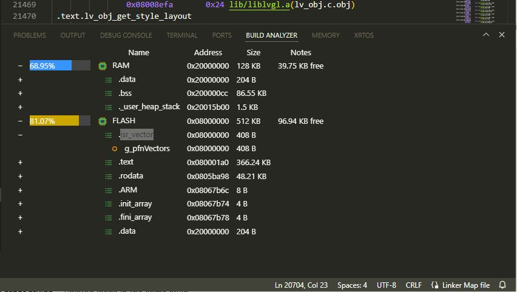

# STM32 Build Analyzer (Enhanced) 🚀  
[](LICENSE)
[](#)

> Visual memory analyzer for STM32 and other embedded projects using supported
> MAP and executable formats, independently of the build system.

> **1.2.0 pre-release:** Multi-toolchain analysis is ready for opt-in testing
> under the existing STM32 Build Analyzer (Enhanced) name. Project identity,
> command IDs, and settings remain unchanged in this test release.



---

## ❓ Why This Fork?

The original version was depandet with cmake-tool extension.  
This fork removes that dependency, adds broader file handling, and enhances the UI for developers using VSCode, CMake, Makefiles, or any other custom setups.

---

## 🚀 Key Improvements in This Fork

✅ **Removed CMake dependency** – Works with any build system (Makefile, CubeIDE, etc.)  
✅ **Custom build folder support** – Easily set via UI button or command  
✅ **Improved file discovery** – More robust handling of `.map` and `.elf` files, multi build folders handling,   
✅ **Optimized UI** – Visual memory usage indicators, serach option and sortable symbol view  

---

## 🔍 Features

- Memory region analysis using `.map` and `.elf` files
- Detailed breakdown of memory sections and symbols
- Clickable links from symbols to source files
- Visual panel with color-coded usage (RAM, Flash)
- Sorting by symbol name/address/size within each section
- Search filter for regions/sections/symbols with optional case sensitivity
- GNU Arm, GNU RISC-V, verified Espressif GNU Xtensa, native LLD/LLVM, verified armlink MAP, and verified IAR ILINK MAP integration
- Compatible with any build system
- Build multiple folders auto detection
- Option to point manualy to map and elf object (even wihout .elf .map extension)

### Toolchain support in 1.2.0

| Toolchain | Analyzed inputs | Verification level |
| --- | --- | --- |
| GNU Arm Embedded (`arm-none-eabi`) | GNU ld MAP and ELF via `objdump`/`nm` | Existing production behavior retained with regression fixtures |
| GNU RISC-V Embedded | GNU ld MAP and ELF via matching GNU object tools | Real RV32IMAC artifact generated with GNU Binutils 2.42 |
| Espressif GNU Xtensa | GNU ld MAP and ELF via `xtensa-esp-elf` or verified legacy prefixes | Real ESP32, ESP32-S2, and ESP32-S3 artifacts generated with GCC 16.1.0/Binutils 2.46 |
| LLVM/Clang with LLD | Native LLD MAP, ELF, and a materialized linker script; `llvm-objdump`/`llvm-nm` | Real Cortex-M4 artifact generated with LLVM 18.1.3 |
| Keil/Arm Compiler | Self-contained `armlink` MAP report; no proprietary tool is executed | Arm Compiler 5.06 update 5 verified with a real report; 6.21 format is experimental |
| IAR Embedded Workbench for Arm | Self-contained ILINK MAP report; no proprietary tool is executed | ILINK 7.80.1.28 verified with a real report; 9.50.1 format is experimental |

Support is format- and version-specific. Unknown, conflicting, or unverified
artifacts are reported explicitly instead of being routed through a guessed
adapter. Experimental entries need additional real-world reports before they
can be promoted to verified support.

---

## 📦 Installation

### From VS Code Marketplace

📥 [Marketplace link placeholder](https://marketplace.visualstudio.com/items?itemName=niwciu.stm32-build-analyzer-enhanced#)

### Manual Installation

#### Requirements

1. Node.js installed  
2. npm installed  
3. `vsce` installed:
   ```bash
   npm install -g @vscode/vsce
   ```

#### Build and Install manual
1. Clone the repository:
   ```bash
   git clone https://github.com/niwciu/stm32-build-analyzer.git
   cd stm32-build-analyzer
   ```
2. Install dependencies:
   ```bash
   npm install
   ```
3. Build the .vsix package using vsce:
   ```bash
   npm run vsix:pre-release
   ```
4. This will generate a file like: `stm32-build-analyzer-enhanced-1.2.0.vsix`

5. Install the extension in VS Code: 
   ```bash
   code --install-extension stm32-build-analyzer-enhanced-1.2.0.vsix
   ```


---

## 🛠 Usage

- Open the Command Palette (`Ctrl+Shift+P`) and run:
  - `STM32 Build Analyzer` – opens the main view
  - `STM32 Build Analyzer Refresh Paths` – re-detects build output folder
  - `STM32 Build Analyzer Add Manual Build Pair` – add a manual map/elf pair via prompts
- Analyzer view updates automatically when build output files change.
- Click the button next to **Name**, **Address**, or **Size** headers to sort symbols within a section (click again to toggle ascending/descending).

---

## ⚙️ Configuration

The extension auto-detects `.map` files paired by basename with `.elf`, Keil `.axf`, or IAR `.out` executables in common build folders. If your build outputs use different names or the executable has no extension, configure a manual pair so the analyzer can still select the correct files.

### How auto-detection works

1. If either `mapFilePath` or `elfFilePath` is configured, both settings must point to readable files. A valid explicit pair is used directly and skips scanning; an incomplete or inaccessible pair produces a clear configuration error.
2. When neither explicit path is configured, the extension asynchronously scans every root in a multi-root workspace for `.map` and `.elf`/`.axf`/`.out` files with the same basename and treats each matching pair as a build output. Directory symlinks and common dependency/tooling folders are skipped.
3. Manual pairs whose output files have not been built yet are skipped. Available manual and automatically discovered pairs remain selectable.
4. If multiple available pairs are found, you will be prompted to pick the build output. Configure a manual pair when the MAP and ELF names differ.

### Toolchain path behavior

When `toolchainPath` is set, the extension resolves variables and workspace-relative paths, detects the build's supported toolchain family, then uses the matching object tools from that directory. Supported RISC-V prefixes include the common `riscv64-unknown-elf-`, `riscv32-unknown-elf-`, and `riscv*-none-elf-` variants. Verified Xtensa support covers Espressif's `xtensa-esp-elf-` toolchain for ESP32, ESP32-S2, and ESP32-S3, plus their legacy chip-specific prefixes. Native LLD builds use `llvm-objdump` and `llvm-nm`; the extension automatically searches from the build output toward the workspace root for an unambiguous materialized linker script with literal `MEMORY` values.
If it is **not** set, tools are resolved from your system `PATH`. If a configured directory is missing an individual binary, the extension reports it and falls back to that tool from `PATH`. Tool execution failures are shown as errors instead of displaying misleading `0 B` usage.
Changes to path settings take effect automatically without reloading the VS Code window.
Unset environment variables and unknown named workspace folders are reported explicitly instead of being replaced with an empty string.
`mapFilePath` and `elfFilePath` must be configured together, and invalid explicit paths are reported instead of being silently replaced by automatic discovery. Structurally invalid manual entries and unresolved variables are also reported, while valid manual pairs with outputs that have not been built yet are skipped until those files become available.

### Settings reference

| Setting | Type | Default | Description |
| --- | --- | --- | --- |
| `stm32BuildAnalyzerEnhanced.mapFilePath` | string | `""` | Absolute or workspace-relative path to the `.map` file. Supports `${userHome}`, `${workspaceFolder}`, `${workspaceFolder:Name}`, and `${env:VAR}`. |
| `stm32BuildAnalyzerEnhanced.elfFilePath` | string | `""` | Absolute or workspace-relative path to an `.elf`, `.axf`, or `.out` executable artifact. The legacy setting name is retained for compatibility. Supports `${userHome}`, `${workspaceFolder}`, `${workspaceFolder:Name}`, and `${env:VAR}`. |
| `stm32BuildAnalyzerEnhanced.toolchainPath` | string | `""` | Absolute or workspace-relative path to supported GNU or LLVM object-tool binaries. Supports `${userHome}`, `${workspaceFolder}`, `${workspaceFolder:Name}`, and `${env:VAR}`. |
| `stm32BuildAnalyzerEnhanced.manualBuildPairs` | array | `[]` | List of manual map/elf pairs for builds with non-matching names or locations. Unbuilt pairs are skipped. Path fields support the same variables as the individual path settings. |
| `stm32BuildAnalyzerEnhanced.debug` | boolean | `false` | Enable verbose logging for debugging purposes. |

### Manual map/elf pairs

Add one or more entries in **Settings → STM32 Build Analyzer (Enhanced) → Manual Build Pairs**:

```json
"stm32BuildAnalyzerEnhanced.manualBuildPairs": [
  {
    "label": "Release build",
    "folder": "build/Release",
    "map": "firmware.map",
    "elf": "firmware.out"
  }
]
```

Paths can be absolute or relative. `map` and `elf` paths may be relative to the `folder` when provided.
Manual pairs are treated as alternative build outputs: a pair is offered only when both configured files are readable. This allows projects with many configurations to analyze whichever outputs are currently built without requiring every configured pair to exist.

You can also add a manual pair from the Command Palette using **STM32 Build Analyzer Add Manual Build Pair**, which writes a new entry into the settings for you.

---

## 📜 Changelog

See [CHANGELOG.md](CHANGELOG.md) for full version history.

---

## 🤝 Contributing
 
Contributions are welcome! Please fork the repo and submit a pull request:

1. Fork the repository
2. Create your feature branch (`git checkout -b feature-name`)
3. Commit your changes (`git commit -m "Add feature"`)
4. Push to branch (`git push origin feature-name`)
5. Open a Pull Request

If you find bugs or want to request features, feel free to [open an issue](https://github.com/niwciu/stm32-build-analyzer/issues).


---

## ⚖️ License & Attribution

This extension is licensed under the [MIT License](LICENSE).  
Originally created by Aleksei Perevozchikov ([ATwice291](https://github.com/ATwice291))  
Fork maintained by [niwciu](https://github.com/niwciu) with enhancements described above.

---

<!-- SEO note -->
STM32 build analyzer for memory usage, symbol tracking, and map/elf inspection – compatible with Makefiles, CubeIDE, and other toolchains.

## ❤️ Thank you for using this version of STM32 Build Analyzer!

</br></br>
<div align="center">

***


***
</div>
